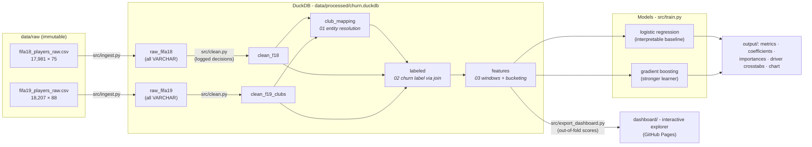

# Pipeline Architecture

One command (`python src/run_pipeline.py`) runs the whole graph left to right;
every arrow is a stage boundary with a persisted artifact behind it.

## Stage responsibilities

| Stage | Owner | Why there |
|---|---|---|
| Ingest | `src/ingest.py` | Raw CSVs land in DuckDB as all-VARCHAR tables - byte-faithful raw layer, no parser-default type guesses. |
| Clean | `src/clean.py` (pandas) | Row-level work: money-string parsing, dedup, type coercion. Every decision emits a line in [cleaning_log.md](cleaning_log.md). |
| Transform | `sql/01–03` (DuckDB SQL) | Set-level work: majority-vote entity resolution, the label join, window-function squad features, CASE bucketing. Versioned `.sql` files are the source of truth - the dbt separation, without the dbt dependency. |
| Model | `src/train.py` | Two-model comparison, imbalance-aware metrics, interpretability artifacts. |

## Why DuckDB

An embedded analytical database: full SQL (window functions, `MEDIAN`,
`IS DISTINCT FROM`) running in-process against a single file - no server to
install, secure, or keep running, which is exactly the modern-data-stack
trade (DuckDB is to OLAP what SQLite is to OLTP). The pipeline stays
one-command reproducible on any machine, and the SQL is portable to a
warehouse (Snowflake/BigQuery) with minimal edits if the data outgrew a
laptop - which at 18K rows it does not.
